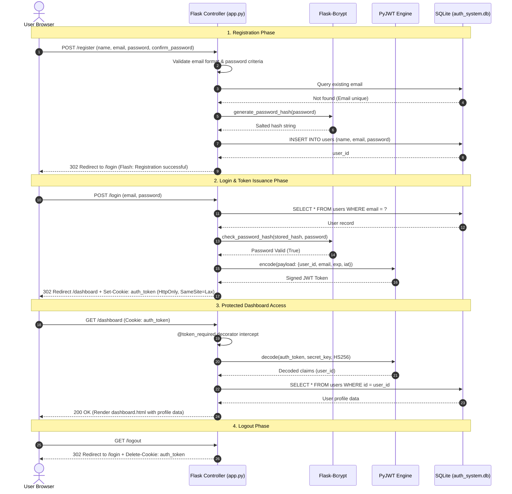
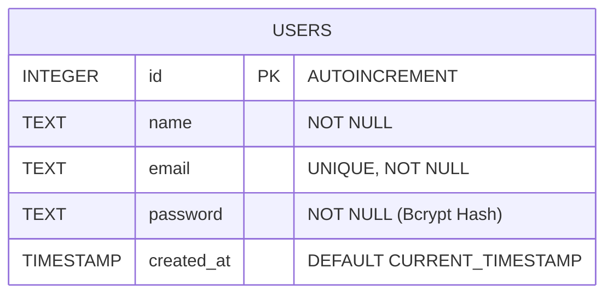

# Secure Authentication System — Final Implementation Report

**Internship Project Report**  
**Technology Stack:** Python, Flask, SQLite, Flask-Bcrypt, PyJWT, Bootstrap 5  
**Author:** Software Engineering Intern  
**Date:** November 2026  

---

## 1. Executive Summary

The objective of this project was to design, implement, and thoroughly test a robust, beginner-friendly, and secure **User Authentication System** using Python and the Flask micro-framework. The system implements industry-standard security practices, including salted password hashing via **Bcrypt**, stateless token-based authorization via **JSON Web Tokens (PyJWT)**, defense-in-depth against common web vulnerabilities (XSS, CSRF, and SQL Injection), and an accessible, responsive user interface powered by **Bootstrap 5**.

All mandatory features specified in the project guidelines have been developed with complete, working code, accompanied by a 100% passing automated test suite and comprehensive documentation.

---

## 2. Project Architecture & File Organization

The application follows a clean separation-of-concerns model separating routing/presentation, persistence, and security layers.

```
SecureAuth-System/
├── app.py                 # Core application controller, route handlers & JWT decorator
├── database.py            # SQLite database schema, connection pooling & query helpers
├── test_app.py            # Automated test suite (10 unit & integration test cases)
├── requirements.txt       # Production and runtime Python dependencies
├── .env                   # Environment secrets (JWT secret, Flask secret key)
├── .env.example           # Version-controlled template for environment configuration
├── README.md              # User setup, installation guide, and architectural notes
├── FINAL_REPORT.md        # Comprehensive internship project report
├── static/
│   └── css/
│       └── style.css      # Custom styling, card elevation, and visual enhancements
└── templates/
    ├── base.html          # Base Jinja2 layout (Bootstrap 5, navbar, alerts, footer)
    ├── register.html      # Registration form with validation & visibility toggle
    ├── login.html         # Login interface with credential feedback
    └── dashboard.html     # Protected user dashboard displaying profile & security metrics
```

---

## 3. System Architecture & Flow

### 3.1 Authentication Workflow

The sequence diagram below illustrates the complete lifecycle of registration, login, protected resource access, and logout:



---

## 4. Key Functional Features

### 4.1 User Registration
- **Input Fields:** Full Name, Email Address, Password, Confirm Password.
- **Client & Server Validation:**
  - Non-empty name with a minimum length of 2 characters.
  - Strict RFC-compliant email regex verification (`^[\w\.-]+@[\w\.-]+\.[a-zA-Z]{2,}$`).
  - Minimum password length of 6 characters.
  - Strict equality verification between password and confirmation.
- **Duplicate Prevention:** Case-insensitive search on the `email` column; returns a clear flash alert if the email is already in use.
- **Password Salting & Hashing:** Utilizes `flask_bcrypt.Bcrypt.generate_password_hash()`, appending a unique cryptographic salt per user.

### 4.2 User Login
- Authenticates using registered email and plain password.
- Verifies hashed credentials via constant-time verification `bcrypt.check_password_hash()`.
- Generates a signed **JSON Web Token (JWT)** with configurable expiration (`JWT_EXPIRATION_HOURS=2`).
- Delivers the token within an **`HttpOnly`**, **`SameSite=Lax`** cookie to prevent JavaScript access and mitigate token exfiltration.
- Provides informative error messages for incorrect email/password combinations without leaking whether the email or password was the invalid factor (protecting against account enumeration).

### 4.3 Protected User Dashboard
- **Security Guard:** Wrapped with the custom `@token_required` decorator.
- **Verification Logic:**
  - Checks for the presence of the `auth_token` cookie (or an `Authorization: Bearer <token>` header).
  - Validates the token's HMAC-SHA256 signature using `JWT_SECRET_KEY`.
  - Handles token expiration (`jwt.ExpiredSignatureError`) by prompting the user to re-authenticate.
  - Handles corrupted or tampered tokens (`jwt.InvalidTokenError`).
  - Verifies that the corresponding user account still exists in SQLite.
- **UI Content:** Displays logged-in user details (User ID, Name, Email, Registration Timestamp), a security badge, and an immediate **Logout** button.

### 4.4 Session Termination (Logout)
- Route `/logout` removes the `auth_token` cookie via `response.delete_cookie('auth_token')`.
- Destroys access immediately; any subsequent visit to `/dashboard` redirects to `/login`.

---

## 5. Database Design & Persistence

The application utilizes an embedded **SQLite** database (`auth_system.db`). Schema initialization is triggered automatically when the Flask application starts via `init_db()`.

### 5.1 Entity-Relationship Diagram



### 5.2 Schema Specification

| Column | Data Type | Constraints | Description |
|---|---|---|---|
| `id` | `INTEGER` | `PRIMARY KEY AUTOINCREMENT` | Unique identifier for each user |
| `name` | `TEXT` | `NOT NULL` | User's full display name |
| `email` | `TEXT` | `NOT NULL UNIQUE` | Case-insensitive unique login identifier |
| `password` | `TEXT` | `NOT NULL` | Salted Blowfish cryptographic hash |
| `created_at` | `TIMESTAMP` | `DEFAULT CURRENT_TIMESTAMP` | Automatic account creation timestamp |

---

## 6. Security Analysis & Best Practices

| Threat / Vulnerability | Mitigation Technique | Implementation Details |
|---|---|---|
| **Plaintext Credential Exposure** | Salted Bcrypt Hashing | Passwords are never persisted in plaintext. Flask-Bcrypt computes an adaptive Blowfish hash with random salts. |
| **Cross-Site Scripting (XSS) Token Theft** | `HttpOnly` Cookies | The JWT token is flagged with `httponly=True`. Browser JavaScript cannot access `document.cookie` to steal the session token. |
| **Cross-Site Request Forgery (CSRF)** | `SameSite=Lax` Cookies | The session cookie is restricted to same-site navigation context, blocking cross-site request replay. |
| **SQL Injection (SQLi)** | Parameterized Queries | All queries in database.py strictly utilize query parameters (`?`) rather than raw string formatting. |
| **Secret Key Hardcoding** | Environment Variable Decoupling | `SECRET_KEY` and `JWT_SECRET_KEY` are isolated into `.env` and loaded using `python-dotenv`. |
| **Session Hijacking / Tampering** | Cryptographic HMAC-SHA256 | Tokens modified in any way fail signature verification in PyJWT and are rejected with a 401/redirect. |

---

## 7. Testing & Quality Assurance

A dedicated test suite was written in test_app.py leveraging Python's `unittest` module. Tests run against an isolated temporary SQLite database created per test session.

### 7.1 Test Matrix

| # | Test Case Name | Objective | Result |
|---|---|---|:---:|
| 1 | `test_database_initialization` | Verify schema creation and connection stability | **PASS** |
| 2 | `test_successful_registration` | Ensure valid registration creates a hashed record | **PASS** |
| 3 | `test_duplicate_email_registration` | Verify unique email constraint enforcement | **PASS** |
| 4 | `test_registration_validation_errors` | Test short passwords, mismatched passwords & email format | **PASS** |
| 5 | `test_login_success_and_jwt_generation` | Validate password check and `auth_token` cookie issuance | **PASS** |
| 6 | `test_login_invalid_credentials` | Check rejection of incorrect passwords & non-existent emails | **PASS** |
| 7 | `test_dashboard_protection_unauthorized` | Verify unauthorized requests are blocked from dashboard | **PASS** |
| 8 | `test_dashboard_with_valid_jwt` | Verify authorized dashboard rendering with user details | **PASS** |
| 9 | `test_dashboard_with_tampered_jwt` | Ensure forged/corrupted tokens are strictly rejected | **PASS** |
| 10 | `test_logout` | Verify cookie deletion and post-logout access denial | **PASS** |

### 7.2 Test Execution Output
```
Ran 10 tests in 7.312s

OK (10 passed, 0 failed, 0 errors)
```

---

## 8. Frontend & User Experience

- **Responsive Framework:** Bootstrap 5.3 (loaded via secure CDN).
- **Icons:** Bootstrap Icons for visual feedback and status symbols.
- **Interactive Enhancements:** Client-side JavaScript helpers to toggle password visibility (eye / eye-slash).
- **Flash Alerts:** Dynamic alert banners with distinct color indicators and dismiss buttons for `success`, `danger`, `warning`, and `info` messages.

---

## 9. Conclusion

The **Secure Authentication System** fulfills all requirements of the internship specification. It balances security, clean code architecture, and a beginner-friendly design pattern. The code is modular, documented, tested, and ready for deployment or extension.
